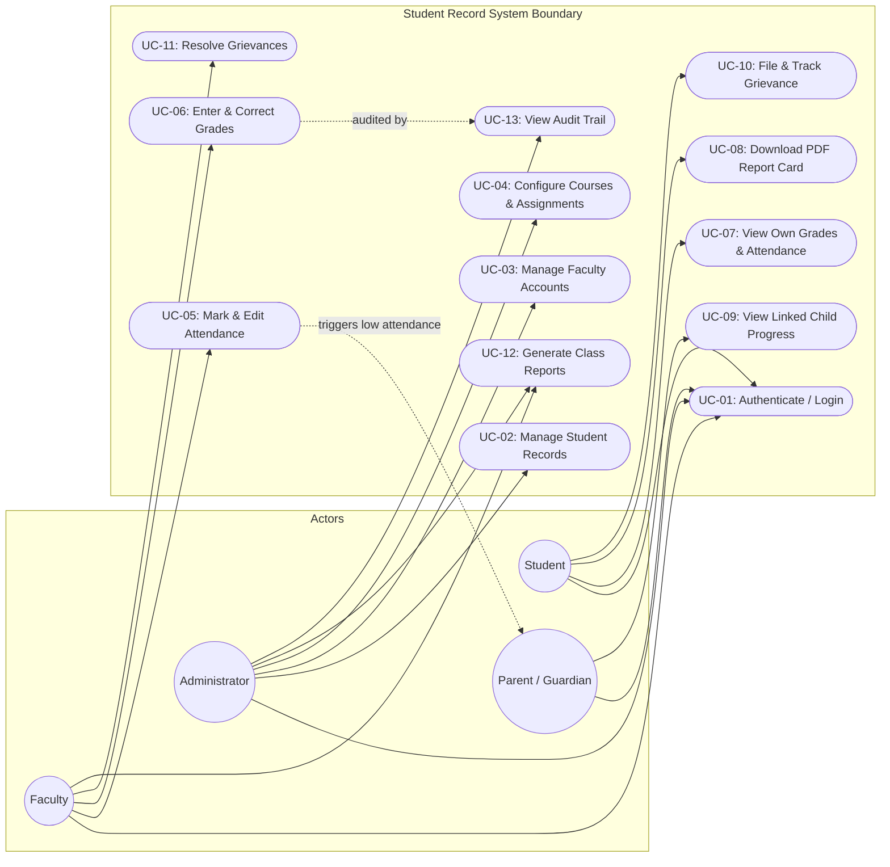

# Student Record System
## Software Requirements Specification (SRS)
**Deliverable 1 of 4 - Mini-Project Part 1**  
*Prepared following IEEE Std 830-1998 Recommended Practice for Software Requirements Specifications*

---

| **Attribute** | **Details** |
|---|---|
| **Document ID** | SRS-SRSYS-01 |
| **Version** | 1.0 |
| **Release Date** | 28 September 2026 |
| **Team Name** | TEAM-E12 |
| **Course** | Software Engineering Mini-Project |

### Team Members & GitHub Profiles
| Name | Student SRN / USN | GitHub Profile | Role |
|---|---|---|---|
| **Nagashree R Patil** | PES1UG24CS289 | [@Nagashri2304](https://github.com/Nagashri2304) | Full Stack & QA / Attendance Lead |
| **Monika PM** | PES1UG24CS275 | [@Monikapm19](https://github.com/Monikapm19) | Backend & Security / Auth Lead |
| **Kushita K** | PES1UG24CS247 | [@Kushitha30](https://github.com/Kushitha30) | Full Stack & DB / Course Management Lead |
| **Nidhi L** | PES1UG24CS298 | [@nidhilokesh1](https://github.com/nidhilokesh1) | Frontend UI/UX & Portal Lead |

---

## Table of Contents
1. [Introduction](#1-introduction)
   - 1.1 Purpose
   - 1.2 Scope
   - 1.3 Definitions, Acronyms, and Abbreviations
   - 1.4 References
   - 1.5 Document Overview
2. [Overall Description](#2-overall-description)
   - 2.1 Product Perspective
   - 2.2 Product Functions Summary
   - 2.3 User Classes and Characteristics
   - 2.4 Operating Environment
   - 2.5 Design and Implementation Constraints
   - 2.6 Assumptions and Dependencies
3. [Specific Requirements - Functional Requirements](#3-specific-requirements---functional-requirements-fr)
4. [Non-Functional Requirements (NFR)](#4-non-functional-requirements-nfr)
5. [Security Requirements](#5-security-requirements)
   - 5.1 Security Objectives
   - 5.2 Security Requirements (SEC-01 to SEC-09)
6. [External Interface Requirements](#6-external-interface-requirements)
7. [UML Use Case Diagram](#7-uml-use-case-diagram)
   - 7.1 Diagram Representation
   - 7.2 Detailed Use Case Descriptions
8. [Appendices](#8-appendices)

---

## 1. Introduction

### 1.1 Purpose
This Software Requirements Specification (SRS) establishes the complete functional, non-functional, security, and interface specifications for the **Student Record System**, developed by **TEAM-E12**. It serves as the primary agreement contract between the academic evaluation panel and the engineering team, guiding design, development, quality assurance, and verification according to IEEE Std 830-1998.

### 1.2 Scope
The Student Record System is an enterprise web application designed to centralize and automate student academic management for higher educational institutions.
The system provides:
- **Administrative Management:** Complete lifecycle management of students, faculty accounts, departments, and course assignments.
- **Faculty Operations:** Course-scoped grading with automated letter-grade evaluation, audit-backed mark corrections, and per-session attendance logging with strict 24-hour edit windows.
- **Student Self-Service:** Secure portal to view personal transcripts, real-time attendance percentages, download tamper-proof PDF report cards, update personal contact info, and lodge academic grievances.
- **Parent / Guardian Oversight:** Dedicated read-only portal linked to dependent student academic and attendance progress.
- **Institutional Governance:** Class performance reporting, automated low-attendance warnings, and an immutable audit log of all database transactions.

*Out of Scope for Part 1:* Native mobile apps (iOS/Android), offline data synchronization, financial fee billing, and legacy LMS migration.

### 1.3 Definitions, Acronyms, and Abbreviations
| Term | Definition |
|---|---|
| **SRS** | Software Requirements Specification (IEEE 830) |
| **FR** | Functional Requirement |
| **NFR** | Non-Functional Requirement |
| **RBAC** | Role-Based Access Control |
| **JWT** | JSON Web Token (RFC 7519) |
| **ACID** | Atomicity, Consistency, Isolation, Durability |
| **WCAG** | Web Content Accessibility Guidelines |
| **RPO / RTO** | Recovery Point Objective / Recovery Time Objective |

### 1.4 References
1. IEEE Std 830-1998: *IEEE Recommended Practice for Software Requirements Specifications*.
2. ISO/IEC/IEEE 29148:2018: *Systems and software engineering - Life cycle processes - Requirements engineering*.
3. OWASP Top 10:2021 Security Standards.
4. Mini-Project Course Syllabus & Deliverables Specification (ETA: Part-1 Sept 2026, Part-2 Oct 2026).

### 1.5 Document Overview
Section 2 details the product perspective, architectural context, and user characteristics. Section 3 formalizes the 17 Functional Requirements. Section 4 specifies 10 measurable Non-Functional Requirements. Section 5 details the security objectives and 9 security requirements. Section 6 provides interface requirements. Section 7 presents the UML Use Case Diagram and descriptions. Section 8 includes appendices.

---

## 2. Overall Description

### 2.1 Product Perspective
The system is implemented as a 3-tier client-server web architecture:
1. **Presentation Tier:** Responsive Single Page Application (SPA) using React.js and Vite.
2. **Application Tier:** Stateless RESTful Web Service using Node.js, Express, and JSON Web Tokens.
3. **Data Tier:** Relational Database Management System (PostgreSQL) enforcing relational constraints, foreign keys, and transaction atomicity.

### 2.2 Product Functions Summary
- Authentication & Session Security (RBAC, JWT)
- Student Record CRUD & Status Tracking
- Faculty Roster & Course Assignment
- Marks Recording & Automatic Letter Grading
- Attendance Marking (Present/Absent/Late) & Percentage Computation
- Automated Low-Attendance Threshold Notifications (< 75%)
- Comprehensive Reporting & PDF Report Card Export
- Student Grievance Filing and Faculty Resolution Workflow
- Append-Only Audit Logging of Sensitive Database Mutations

### 2.3 User Classes and Characteristics
| User Class | Description | Technical Proficiency | Access Rights |
|---|---|---|---|
| **Administrator** | Institutional academic registrar | Moderate | Unrestricted access across students, faculty, courses, system reports, and audit logs. |
| **Faculty** | Professors and course instructors | Moderate | Manage grades, attendance, and grievances solely for courses assigned to them. |
| **Student** | Enrolled undergraduate/graduate students | High | Read-only access to own academic records, report cards, grievances, and editable contact details. |
| **Parent / Guardian**| Parents or guardians of enrolled students | General | Read-only access strictly confined to their linked student(s). |

### 2.4 Operating Environment
- **Server:** Node.js v20+ LTS / Express on Linux / Windows Server, PostgreSQL 15+.
- **Client Browsers:** Google Chrome (>= v115), Mozilla Firefox (>= v115), Microsoft Edge (>= v115), Apple Safari (>= v16). Viewports from 360px (mobile) to 4K desktop.

### 2.5 Design and Implementation Constraints
1. Strict adherence to HTTPS / TLS 1.2+ for all network interactions.
2. Modern web technologies: React.js (frontend), Node.js & Express (backend), PostgreSQL (persistence).
3. Delivery within the academic sprint schedule with complete traceability.

### 2.6 Assumptions and Dependencies
1. Institutional enrollment data is accessible for database seeding.
2. Client devices run a modern ECMAScript-compliant web browser.
3. Network connectivity is available for REST API communication.

---

## 3. Specific Requirements - Functional Requirements (FR)

| ID | Priority | Actor(s) | Functional Requirement Statement | Acceptance & Verification Criteria |
|---|---|---|---|---|
| **FR-01** | High | All Users | The system shall authenticate every user via username/email and password, issuing a signed, role-scoped JWT valid for 30 minutes. | Valid credentials navigate to the role-specific dashboard within 2s. Invalid credentials return HTTP 401 with standard error format and create no session. |
| **FR-02** | High | Admin | The system shall allow an Administrator to create student records containing roll number, full name, date of birth, department, semester, and guardian contact. | New record persisted and queryable within 2s. Duplicate roll numbers are rejected with HTTP 409 Conflict. Mandatory fields validated. |
| **FR-03** | High | Admin | The system shall allow an Administrator to update student records and soft-delete/deactivate student accounts with confirmation. | Updates reflect immediately. Deactivated students are excluded from active course rosters but retained in the DB for audit compliance. |
| **FR-04** | High | Admin | The system shall allow an Administrator to create, edit, and deactivate Faculty accounts with temporary password issuance. | Faculty accounts created with forced password reset on initial login. Deactivated faculty cannot log in. |
| **FR-05** | Medium | Admin | The system shall allow an Administrator to configure courses per semester and assign courses to one or more faculty members. | Course created with code, name, and semester. Assigned faculty see the course in their roster; unauthorized faculty cannot view or alter it. |
| **FR-06** | High | Faculty | The system shall allow a Faculty member to enter marks (0-100) for enrolled students in assigned courses and automatically compute letter grades (S, A, B, C, D, E, F). | Non-numeric or marks outside [0, 100] rejected with HTTP 400. Letter grade calculation matches institutional scale. Unassigned course access rejected with HTTP 403. |
| **FR-07** | Medium | Faculty | The system shall allow a Faculty member to amend previously entered marks only when providing a mandatory audit reason. | Mark amendment without justification rejected with HTTP 400. Old mark, new mark, author, timestamp, and justification recorded in audit log. |
| **FR-08** | High | Faculty | The system shall allow Faculty to record per-session attendance (Present, Absent, Late) for assigned courses with an edit window of exactly 24 hours. | Attendance persisted with timestamp. Edits attempted after 24 hours rejected with HTTP 403 (EDIT_WINDOW_EXPIRED) unless performed by Admin. |
| **FR-09** | High | Faculty | The system shall dynamically compute course-wise and cumulative attendance percentages upon every attendance submission. | Computed percentage matches mathematical formula `(Present + Late) / Total * 100` to 1 decimal place and updates within 2 seconds. |
| **FR-10** | High | Student | The system shall allow Students to view only their own personal grades, semester GPA, and attendance records. | Student queries return own records. Attempting to query another student ID returns HTTP 403 Forbidden with zero data disclosure. |
| **FR-11** | Medium | Student | The system shall generate and allow Students to download a signed, comprehensive academic report card in PDF format. | PDF generated within 5 seconds containing institutional header, student roll number, name, course marks, letter grades, and attendance summary. |
| **FR-12** | Medium | Parent | The system shall allow Parents/Guardians to view academic progress and attendance exclusively for their verified linked student(s). | Parent view displays linked child data. Request for unlinked student returns HTTP 403. |
| **FR-13** | Medium | Parent, Student, Admin | The system shall trigger automated notifications when a student's attendance drops below the institutional threshold (75%). | Alert record generated within 5 minutes of attendance update crossing threshold; warning displayed on student and parent dashboards. |
| **FR-14** | High | Admin, Faculty | The system shall allow Administrators (all courses) and Faculty (assigned courses) to generate class-level analytics and export records to CSV and PDF. | Report for 100 students generated in <= 3 seconds; exported tabular data matches database state exactly. |
| **FR-15** | Low | Student, Faculty | The system shall allow Students to submit grievances regarding grade or attendance records and allow Faculty to update grievance status (Open, In Review, Resolved). | Grievance stored with reference ID. Assigned faculty notified; student can track resolution notes and status transitions. |
| **FR-16** | High | Admin | The system shall capture every state-altering operation (create, update, delete) on student, grade, and attendance entities in an append-only audit log. | 100% of mutations generate an audit log entry containing User ID, Role, IP, Timestamp, Entity, Old Value, and New Value. No UPDATE/DELETE permitted on log. |
| **FR-17** | Low | Student | The system shall allow Students to update their personal contact details (phone, email, residential address) while strictly disallowing edits to academic data. | Contact updates saved and verified immediately. Modifications targeting marks, attendance, or enrollment rejected with HTTP 403. |

---

## 4. Non-Functional Requirements (NFR)

| ID | Category | Requirement Statement | Verification Method |
|---|---|---|---|
| **NFR-01** | **Performance** | At least 95% of standard API transactions (excluding large PDF generation) shall respond within 2.0 seconds under a concurrent load of 200 active users. | Automated load testing via Apache JMeter. |
| **NFR-02** | **Reporting Speed** | Class-wise aggregated attendance and grade reports for cohorts up to 100 students shall render and export in <= 3.0 seconds. | Performance benchmark timing. |
| **NFR-03** | **Scalability** | The database schema and indexes shall support at least 10,000 active student records and 200,000 attendance entries without exceeding the 2.0s response threshold. | Synthetic data seeding and stress testing. |
| **NFR-04** | **Availability** | The production application shall maintain an operational availability of at least 99.0% between 07:00 and 22:00 IST on a monthly basis. | Cloud health uptime monitor. |
| **NFR-05** | **Usability** | A first-time faculty user shall successfully log attendance or enter grades within 10 minutes without training; core workflows must be reachable in <= 3 clicks. | User evaluation walkthrough. |
| **NFR-06** | **Cross-Platform Compatibility**| The UI shall render correctly across Chrome, Firefox, Safari, and Edge on viewports ranging from 360px mobile to 1920px+ desktop. | Cross-browser responsive testing. |
| **NFR-07** | **Maintainability & Code Quality**| Codebase shall follow modular architecture with automated linting, OpenAPI 3.0 documentation, and >= 70% backend unit test statement coverage. | Jest test coverage & linter reports. |
| **NFR-08** | **Disaster Recovery** | Database shall support automated daily snapshot backups achieving a Recovery Point Objective (RPO) <= 24 hours and Recovery Time Objective (RTO) <= 4 hours. | Database backup/restore drill. |
| **NFR-09** | **Data Integrity** | All financial, grading, and attendance multi-record writes shall execute within ACID transactions; partial writes on failure shall be fully rolled back. | Failure injection tests. |
| **NFR-10** | **Accessibility** | All public and portal interfaces shall conform to WCAG 2.1 Level AA standards with zero critical automated scan violations. | Lighthouse and Axe accessibility audits. |

---

## 5. Security Requirements

### 5.1 Security Objectives
- **SO-1: Confidentiality:** Protect sensitive educational and personal data against unauthorized disclosure or unauthorized horizontal/vertical access.
- **SO-2: Integrity:** Ensure grades, marks, and attendance records are protected from unauthorized modification, tampering, or deletion.
- **SO-3: Availability:** Defend the web service against brute-force attacks, credential stuffing, and volumetric application-level denial of service.
- **SO-4: Authentication & Accountability:** Guarantee that all system actions are non-repudiable and attributable to authenticated identities.

### 5.2 Security Requirements (SEC-01 to SEC-09)
| ID | Mapped Objectives | Security Requirement Statement |
|---|---|---|
| **SEC-01** | SO-1, SO-4 | **Password Security:** Passwords must be at least 8 characters containing upper-case, lower-case, digit, and symbol. Passwords shall be stored strictly as one-way salted `bcrypt` hashes (cost factor >= 10) and never logged or transmitted in plain text. |
| **SEC-02** | SO-1, SO-2 | **Server-Side RBAC:** The API Gateway/Router must enforce server-side Role-Based Access Control on every route. Requests lacking the required role scope must be immediately rejected with HTTP 403 Forbidden. |
| **SEC-03** | SO-1, SO-2 | **Transport Security:** All client-server communication must enforce HTTPS over TLS 1.2 or higher. Plain HTTP requests must be rejected or redirected to HTTPS with HSTS headers enabled. |
| **SEC-04** | SO-4 | **Cryptographic JWT Sessions:** Authentication sessions must utilize cryptographically signed JSON Web Tokens (HMAC-SHA256 or RSA) with a maximum validity of 30 minutes. Tampered or expired tokens must yield HTTP 401 Unauthorized. |
| **SEC-05** | SO-3, SO-4 | **Brute-Force Account Lockout:** Upon 5 consecutive failed login attempts on a single account, the account must be temporarily locked for 15 minutes, returning HTTP 423 Locked. |
| **SEC-06** | SO-1, SO-2 | **SQL Injection & XSS Defense:** All database queries must use parameterized statements or ORM abstractions. All incoming requests must undergo schema validation and output encoding to prevent SQLi and Stored/Reflected XSS. |
| **SEC-07** | SO-2, SO-4 | **Append-Only Audit Trail:** Audit logs must be strictly append-only. The application database user must lack UPDATE and DELETE permissions on the `audit_logs` table. Audit logs must be retained for at least 1 academic year. |
| **SEC-08** | SO-1 | **Object-Level Authorization:** Access control must validate entity ownership (e.g. Student querying own ID, Faculty querying assigned courses). Manipulating URL parameter IDs to access other users' data must return HTTP 403. |
| **SEC-09** | SO-3 | **API Rate Limiting:** The API Gateway must throttle requests to a maximum of 100 requests per minute per IP address. Exceeding requests must receive HTTP 429 Too Many Requests. |

---

## 6. External Interface Requirements

### 6.1 User Interfaces
Single-Page Application (SPA) built with React.js, TailwindCSS / modern styling, providing four dedicated portal views:
- **Admin Dashboard:** Student roster, Faculty directory, Course allocation, System-wide audit viewer.
- **Faculty Dashboard:** Assigned course cards, Interactive attendance grid with 24-hr status locks, Grade entry spreadsheet, Grievance manager.
- **Student Dashboard:** Personal profile card, Overall & course attendance meters, Semester grade summary, PDF report card download trigger, Grievance submission form.
- **Parent Dashboard:** Linked student academic overview, Attendance warning banner, Progress report download.

### 6.2 Software Interfaces
- **API Server:** Express.js REST API exposing endpoints under `/api/v1/`.
- **Database:** PostgreSQL relational database via Node `pg` connection pool with parameterization.
- **Document Generator:** PDFKit / Puppeteer service for compiling cryptographic PDF report cards.

---

## 7. UML Use Case Diagram

### 7.1 Diagram Representation

### 7.2 Detailed Use Case Descriptions (Sample)
- **UC-01 (Authenticate / Login):** Validates credentials, checks account lockout state, updates last login, and returns signed JWT with user roles and claims.
- **UC-05 (Mark Attendance):** Verifies faculty assignment to course, receives attendance array (present/absent/late), verifies 24-hour edit window, computes cumulative percentage, and logs audit record.
- **UC-06 (Enter Grades):** Validates faculty authorization, checks score bounds (0-100), computes letter grade, requires mandatory rationale for amendments, and writes audit record.

---

## 8. Appendices
- **Appendix A:** Traceability Matrix mapping SRS requirements to Architecture Components and Test Cases is detailed in `docs/2_TestPlan_StudentRecordSystem.md` and `docs/3_ArchitectureDesign_StudentRecordSystem.md`.
- **Appendix B:** Data dictionary and schema definitions are detailed in `db/schema.sql` and `docs/3_ArchitectureDesign_StudentRecordSystem.md`.
