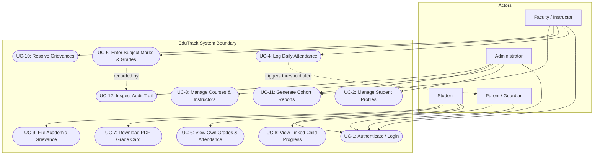

# Software Requirements Specification (SRS)
## Student Record System (EduTrack)
**Mini-Project Deliverable Part-1**  
*Compliant with IEEE Std 830-1998 Standard for Software Requirements Specifications*

---

| **Document Information** | **Specification Details** |
|---|---|
| **Document Identifier** | SRS-EDU-2026-V1 |
| **Release Version** | 1.0.0 (Official Baseline) |
| **Date of Publication** | 15 October 2026 |
| **System Name** | EduTrack - Student Record & Academic Performance System |
| **Engineering Team** | Student Record System Development Team |

### Team Members & Profile Roster
| Full Name | Role | GitHub Profile |
|---|---|---|
| **Nagashree R Patil** | Project Lead & Full-Stack Engineer | [@Nagashri2304](https://github.com/Nagashri2304) |
| **Monika PM** | Backend & Security Architect | [@Monikapm19](https://github.com/Monikapm19) |
| **Kushita K** | Database Engineer & Systems Analyst | [@Kushitha30](https://github.com/Kushitha30) |
| **Nidhi L** | Frontend UI/UX & Integration Engineer | [@nidhilokesh1](https://github.com/nidhilokesh1) |

---

## 1. Introduction

### 1.1 Purpose
This Software Requirements Specification (SRS) establishes the complete functional and non-functional requirements for the **Student Record System (EduTrack)**. The system provides an automated, centralized web platform for academic institutions to manage student demographics, course enrollments, lecture attendance, exam marks, and grade cards. This document serves as the formal foundation for system architecture, testing, and sprint delivery.

### 1.2 Scope
EduTrack replaces error-prone paper registers and siloed spreadsheets with a role-based, secure web platform:
- **Administration:** Lifecycle enrollment of students, faculty accounts, academic terms, and course assignments.
- **Faculty Operations:** Daily session attendance logging with attendance calculations, examination mark entries, and automated letter grade computation.
- **Student Portal:** Real-time visibility into subject attendance percentages, GPA, mark breakdown, and semester grade card downloads.
- **Parent/Guardian Portal:** Dedicated read-only view of linked students' academic performance and proactive alerts when attendance drops below minimum thresholds (<75%).
- **Security & Integrity:** Role-Based Access Control (RBAC), JSON Web Token (JWT) sessions, and non-repudiable audit trails of academic alterations.

### 1.3 Definitions, Acronyms, and Abbreviations
- **SRS:** Software Requirements Specification (IEEE 830).
- **FR:** Functional Requirement.
- **NFR:** Non-Functional Requirement.
- **RBAC:** Role-Based Access Control.
- **JWT:** JSON Web Token (RFC 7519).
- **GPA:** Grade Point Average.
- **ACID:** Atomicity, Consistency, Isolation, Durability.

### 1.4 References
- IEEE Std 830-1998: *Recommended Practice for Software Requirements Specifications*.
- ISO/IEC/IEEE 29148:2018: *Requirements Engineering Process Standards*.
- OWASP Top 10 Application Security Risks (2021).

---

## 2. Overall Description

### 2.1 Product Perspective
EduTrack is a standalone 3-tier web application consisting of:
1. **Client Tier:** Single Page Application built using React.js and Vite.
2. **Application Server Tier:** RESTful API server built using Node.js and Express.
3. **Data Tier:** Relational database management system (PostgreSQL/SQLite) providing ACID transactional guarantees.

### 2.2 User Classes & Roles
| Role | Responsibility & Authority |
|---|---|
| **Administrator** | Institutional management; creates student records, faculty accounts, courses, and department offerings. |
| **Faculty / Instructor** | Manages enrolled student attendance per session, enters marks, reviews grade statistics, and resolves grade disputes. |
| **Student** | Views personal grades, attendance percentages, download semester grade cards, and submits academic inquiries. |
| **Parent / Guardian** | Read-only oversight of their linked child's attendance rate and academic standings. |

### 2.3 Operating Environment
- **Server:** Node.js v20+ LTS, Express v5.
- **Database:** PostgreSQL 15+ / SQLite3.
- **Client Platforms:** Google Chrome (>=115), Mozilla Firefox (>=115), Microsoft Edge (>=115), Apple Safari (>=16).
- **Responsive Viewports:** 360px (mobile) to 1920px+ (desktop).

### 2.4 Design & Implementation Constraints
- Web application architecture utilizing JavaScript (React.js + Node.js).
- All communications must use HTTPS with secure JWT session handling.
- Maximum 20 backlog items divided into two time-boxed Sprints.

---

## 3. Specific Requirements - Functional Requirements (FR)

| ID | Priority | Role | Requirement Statement | Acceptance Criteria |
|---|---|---|---|---|
| **FR-01** | High | All | The system shall authenticate users with email/username and password, returning a signed JWT with role claims. | Valid credentials return HTTP 200 with JWT valid for 30 minutes; invalid credentials return HTTP 401. |
| **FR-02** | High | Admin | The system shall allow Administrators to register and manage student demographic records (Roll Number, Name, DOB, Department, Semester). | Unique roll number enforced; duplicate entries return HTTP 409 Conflict. Soft-deletes supported. |
| **FR-03** | High | Admin | The system shall allow Administrators to create faculty accounts and assign courses to instructors. | Assigned instructors see courses on their roster; unassigned instructors cannot modify course data. |
| **FR-04** | High | Faculty | The system shall enable instructors to record per-session student attendance (Present, Absent, Late) for assigned courses. | Attendance recorded with session date and instructor ID. Edits permitted within 24 hours of session. |
| **FR-05** | High | Faculty | The system shall compute individual and cohort attendance percentages automatically upon attendance submission. | Attendance % matches `(Present + Late) / Total * 100` rounded to 1 decimal place. Updates in < 2 seconds. |
| **FR-06** | High | Faculty | The system shall allow instructors to input numeric exam marks (0-100) and automatically determine letter grades. | Out-of-range marks (>100 or <0) rejected with HTTP 400. Letter grades (S, A, B, C, D, E, F) computed by formula. |
| **FR-07** | Medium | Faculty | The system shall require a mandatory explanation reason whenever previously submitted marks are amended. | Mark updates lacking justification are rejected with HTTP 400. Audit entry logged with previous & new marks. |
| **FR-08** | High | Student | The system shall allow students to access their own academic records, course grades, and attendance metrics only. | Object-level authorization strictly prevents viewing other students' records (HTTP 403 Forbidden). |
| **FR-09** | Medium | Student | The system shall generate downloadable, formatted PDF semester grade cards for students. | PDF generates in <= 3 seconds containing student profile, courses, marks, letter grades, and attendance %. |
| **FR-10** | Medium | Parent | The system shall allow parents/guardians to review grades and attendance strictly for their linked student(s). | Parent views are limited strictly to children mapped in the `parent_links` relationship table. |
| **FR-11** | Medium | System | The system shall trigger automated low-attendance warnings when a student's attendance drops below 75%. | Alert flags displayed on student, faculty, and parent dashboards when threshold is breached. |
| **FR-12** | Low | Student | The system shall allow students to lodge academic evaluation grievances for instructor review. | Grievance created with status `Open`; faculty can review and update status to `Resolved` with response notes. |
| **FR-13** | High | Admin | The system shall record all student record, grade, and attendance alterations in an append-only audit trail. | Every create/update/delete operation writes User ID, Action, Entity, Timestamp, Old Value, and New Value. |
| **FR-14** | Medium | Admin/Faculty | The system shall generate aggregated class performance reports with export to CSV and tabular views. | Summary report displays class average, passing rate, and attendance distribution in <= 3.0 seconds. |
| **FR-15** | Low | Student | The system shall permit students to update personal contact details (phone, email, address) but not academic fields. | Modifications targeting academic marks or attendance via contact update endpoint are rejected with HTTP 403. |

---

## 4. Non-Functional Requirements (NFR)

| ID | Category | Requirement Specification | Verification Method |
|---|---|---|---|
| **NFR-01** | **Performance** | 95% of standard API endpoints shall complete in under 2.0 seconds with 200 concurrent users. | Automated Apache JMeter load tests. |
| **NFR-02** | **Report Latency** | Cohort performance reports and PDF grade card generation shall complete in <= 3.0 seconds. | Server execution timing metrics. |
| **NFR-03** | **Scalability** | Database architecture shall support 10,000 active student records and 200,000 attendance logs without latency degradation. | Synthetic database stress seeding. |
| **NFR-04** | **Availability** | System shall maintain >= 99.0% uptime during core academic operational hours (07:00 to 22:00 IST). | Production health check monitor. |
| **NFR-05** | **Usability** | Core workflows (marking attendance, entering marks) must be accessible within 3 user clicks from login. | User task completion walkthrough. |
| **NFR-06** | **Compatibility** | Web UI must render cleanly across mobile (360px width) and desktop browsers with zero broken layouts. | Cross-browser responsive test suite. |
| **NFR-07** | **Maintainability** | Backend codebase shall maintain >= 70% automated test coverage with modular separation of concerns. | Jest test coverage reporting. |
| **NFR-08** | **Data Integrity** | Multi-row grade and attendance operations shall execute within ACID transactions; partial failures roll back completely. | Fault-injection transaction test. |

---

## 5. Security Requirements

### 5.1 Security Objectives
- **SO-1: Confidentiality:** Ensure educational data (marks, personal details) is accessible strictly to authorized roles and assigned entities.
- **SO-2: Integrity:** Protect grade records and attendance archives against unauthorized manipulation, tampering, or silent deletion.
- **SO-3: Availability:** Protect system endpoints against brute-force password guessing and denial of service abuse.
- **SO-4: Accountability:** Guarantee non-repudiation by logging identity, timestamp, and network address for all data mutations.

### 5.2 Security Requirements (SEC-01 to SEC-04)
| ID | Title | Requirement Statement |
|---|---|---|
| **SEC-01** | **Credential Storage & Lockout** | Passwords must be salted and hashed using `bcrypt` (work factor >= 10). Account must be temporarily locked for 15 minutes after 5 consecutive failed login attempts (HTTP 423). |
| **SEC-02** | **Server-Side RBAC** | Every API route must be verified on the server side using role authorization middleware. Unprivileged access must be rejected with HTTP 403 Forbidden. |
| **SEC-03** | **Cryptographic JWT Sessions** | Sessions must utilize cryptographically signed JSON Web Tokens (HMAC-SHA256) expiring after 30 minutes. Tampered tokens must be rejected with HTTP 401. |
| **SEC-04** | **Injection Defense & Audit Immutability** | All database queries must utilize parameterized SQL statements. State alterations must write to an immutable, append-only `audit_logs` table. |

---

## 6. UML Use Case Diagram

---

## 7. External Interface Requirements

- **User Interface:** Single Page Application (SPA) designed with React 19, Vite, and responsive CSS.
- **REST API:** Express.js API listening on port 5000 with standardized JSON envelopes (`success`, `data`, `error`).
- **Database:** PostgreSQL / SQLite accessed via parameterized queries.
