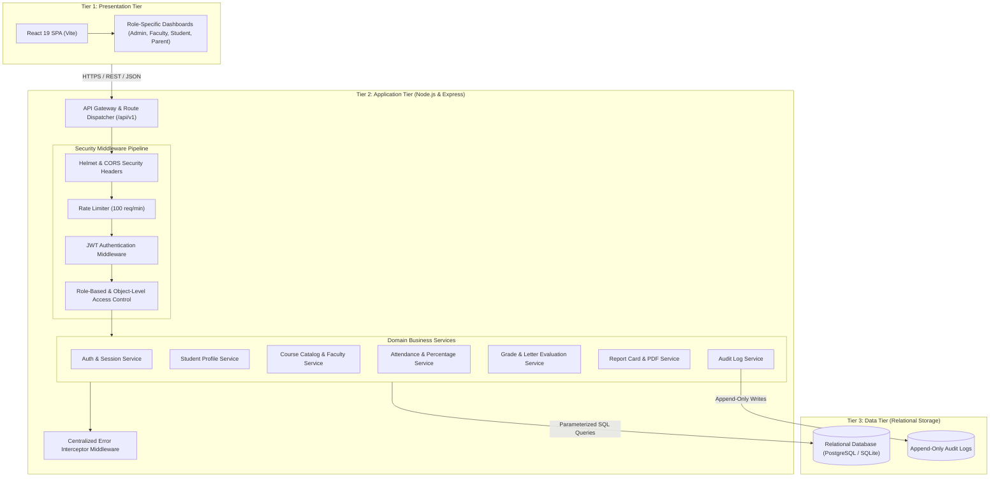
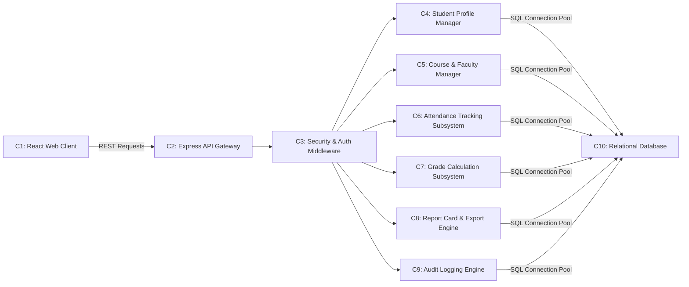
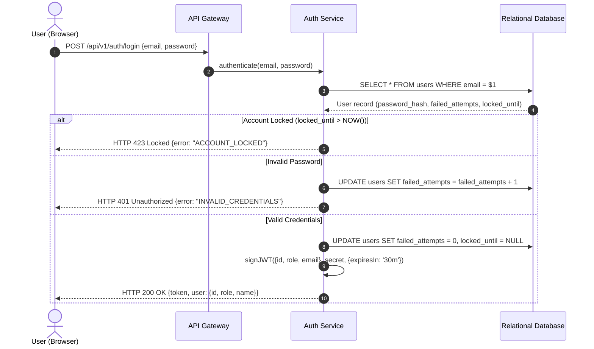
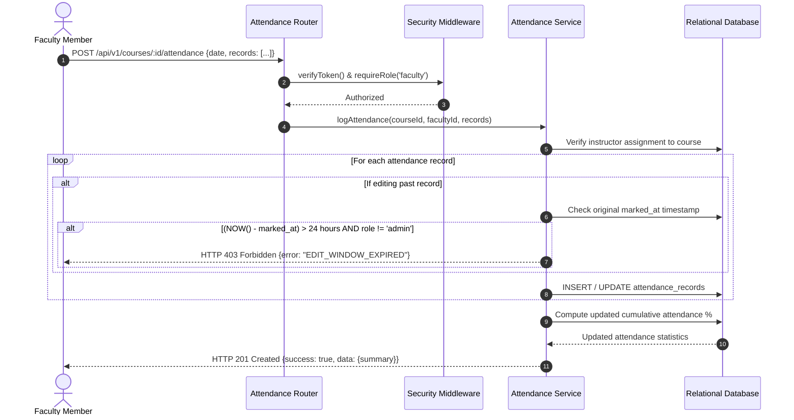
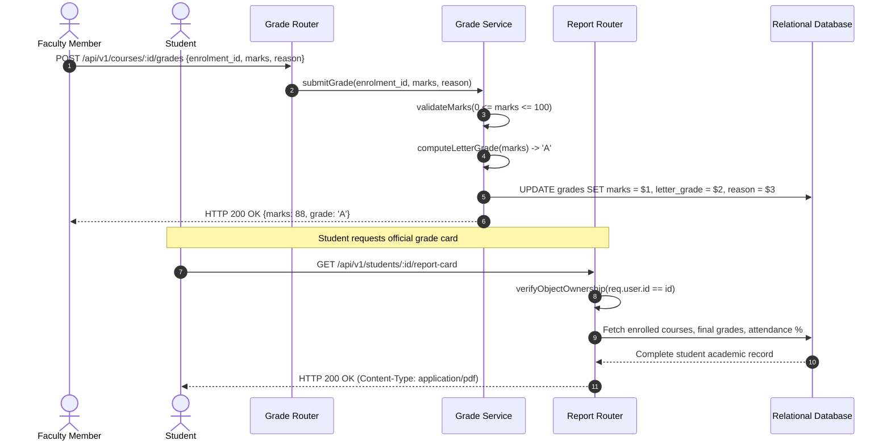
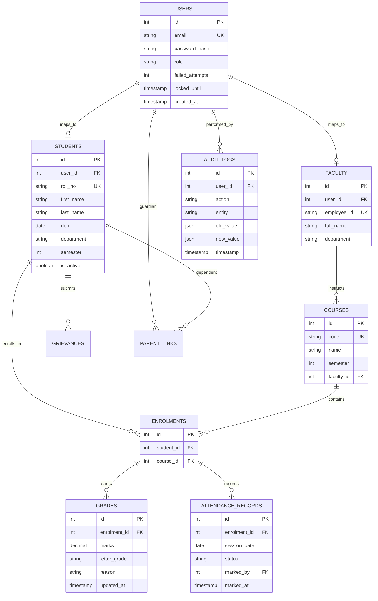

# Software Architecture & Design Specification (SAD)
## Student Record System (EduTrack)
**Mini-Project Deliverable Part-1**  
*Compliant with IEEE Std 1016-2009 (Software Design Descriptions) & ISO/IEC/IEEE 42010*

---

| **Document Information** | **Specification Details** |
|---|---|
| **Document Identifier** | SAD-EDU-2026-V1 |
| **Release Version** | 1.0.0 (Official Baseline) |
| **Date of Publication** | 15 October 2026 |
| **Governing SRS** | SRS-EDU-2026-V1 |
| **Engineering Team** | Student Record System Architecture Team |

### Team Members & Architectural Responsibilities
| Member | Role | Architectural Focus | GitHub Profile |
|---|---|---|---|
| **Nagashree R Patil** | Lead System Architect | Attendance Service, Session Boundary Enforcement & CI Pipeline | [@Nagashri2304](https://github.com/Nagashri2304) |
| **Monika PM** | Security Architect | JWT Session Architecture, Auth Service & RBAC Middleware | [@Monikapm19](https://github.com/Monikapm19) |
| **Kushita K** | Database Architect | Database Relational Modeling, Query Optimization & Course Catalog | [@Kushitha30](https://github.com/Kushitha30) |
| **Nidhi L** | Frontend Architect | React SPA Client Architecture, State Management & Report Cards | [@nidhilokesh1](https://github.com/nidhilokesh1) |

---

## PART A - ARCHITECTURE

## 1. Introduction

### 1.1 Purpose
This document establishes the architectural foundation and detailed software design specifications for the **Student Record System (EduTrack)**. It defines structural tiers, component responsibilities, data flow, API design, security boundaries, and relational schemas necessary to fulfill `SRS-EDU-2026-V1`.

### 1.2 Architectural Drivers
- **Modularity:** High cohesion within domain services (Attendance, Grades, Students, Courses) and loose coupling between presentation and persistence tiers.
- **Defense-in-Depth:** Centralized request validation, cryptographic token verification, and server-side RBAC before controllers execute.
- **Horizontal Scalability:** Stateless application servers with token-based session encapsulation.
- **Transactional Integrity:** ACID guarantees for multi-row student attendance and grading operations.

---

## 2. Architecture Pattern

EduTrack adheres to a **3-Tier Layered Client-Server Architecture**:

---

## 3. Component View and Description

### 3.1 Component Diagram

### 3.2 Component Responsibilities
| Component | Name | Core Responsibilities |
|---|---|---|
| **C1** | React Web Client | SPA views, authentication token storage, interactive attendance grid, grade views. |
| **C2** | Express API Gateway | Route mapping, TLS termination, payload serialization under `/api/v1/*`. |
| **C3** | Security Middleware | Token verification, role whitelist matching, brute-force lockout, rate limiting. |
| **C4** | Student Profile Manager | Student enrollment, soft-deletions, demographic data maintenance. |
| **C5** | Course & Faculty Manager| Course catalog definitions, instructor assignment mappings. |
| **C6** | Attendance Subsystem | Daily session attendance logging, 24-hr edit limit check, percentage formula. |
| **C7** | Grade Subsystem | Mark entry validation (0-100), automated letter grading, amendment justification. |
| **C8** | Report Card Engine | Cohort performance analytics and PDF grade card streaming. |
| **C9** | Audit Logging Engine | Immutable logging of all state mutations with timestamps and identities. |
| **C10**| Relational Database | ACID relational persistence, unique constraints, and foreign key cascades. |

---

## 4. Traceability to Requirements

| Requirement ID | Realizing Architecture Component | Design Mechanism |
|---|---|---|
| **FR-01, SEC-01** | C2, C3 (Auth Service) | Bcrypt password hashing, signed 30-min JWT issuance |
| **FR-02** | C4, C10 (Student Service) | Student table with UNIQUE roll_number constraint |
| **FR-03** | C5, C10 (Course Service) | Foreign key relationship linking courses to faculty users |
| **FR-04, FR-05** | C6, C10 (Attendance Service) | 24-hr timestamp validation, SQL attendance percentage math |
| **FR-06, FR-07** | C7, C9, C10 (Grade Service) | Boundary check [0, 100], automated letter grade mapping, audit reason |
| **FR-08, FR-09** | C1, C8 (Report Service) | Object-level auth check (`req.user.student_id == params.id`), PDFKit engine |
| **FR-10** | C1, C3, C10 | `parent_links` table verification |
| **FR-11** | C6, C8 | Event trigger on attendance update with percentage < 75% |
| **FR-13, SEC-04** | C9, C10 (Audit Engine) | Interceptor writing to append-only `audit_logs` |
| **NFR-01, NFR-03**| C2, C10 | Indexed query execution, connection pooling, sub-2.0s response |
| **SEC-02** | C3 (Security Middleware) | `roleAuth.js` middleware checking role claims on every route |

---

## 5. Security Architecture

### 5.1 Defense-in-Depth Model
1. **Perimeter Layer:** Rate limiting (100 req/min per IP) and Helmet HTTP security headers (CSP, HSTS).
2. **Access Control Layer:** JWT token authentication with 30-minute expiration; server-side RBAC denying unauthorized roles with HTTP 403.
3. **Application Layer:** Strict input validation and sanitization preventing XSS; parameterized queries preventing SQL injection.
4. **Data Layer:** Bcrypt password hashes with salt rounds >= 10; append-only audit trail with restricted database permissions.

### 5.2 STRIDE Threat Model
| Threat Category | Potential Attack Vector | Mitigating Design Control |
|---|---|---|
| **Spoofing** | Forged authentication token | Cryptographically signed HMAC-SHA256 JWT tokens. |
| **Tampering** | Unauthorized grade manipulation | Server-side role check; 24-hr edit lock; mandatory audit justification. |
| **Repudiation** | Denying an unauthorized attendance change | Non-repudiable audit logs recording user ID, IP address, and timestamp. |
| **Information Disclosure**| IDOR: Accessing other students' transcripts | Object-level authorization validating identity claims against requested IDs. |
| **Denial of Service** | Credential stuffing brute-force attack | Account lockout for 15 minutes after 5 consecutive failed attempts. |
| **Elevation of Privilege**| Student accessing admin endpoints | Strict server-side RBAC middleware rejecting unauthorized requests with HTTP 403. |

---

## PART B - DETAILED DESIGN

## 6. UML Sequence Diagrams

### 6.1 SD-1: User Authentication & JWT Issuance (FR-01, SEC-01)

### 6.2 SD-2: Daily Attendance Logging & 24-Hour Edit Lock (FR-04, FR-05)

### 6.3 SD-3: Marks Entry, Letter Grade Evaluation & Grade Card (FR-06, FR-08, FR-09)

---

## 7. REST API Design Specification

| Method | Endpoint | Authorization | Description | Status Codes |
|---|---|---|---|---|
| `POST` | `/api/v1/auth/login` | Public | Authenticates credentials and issues signed 30-min JWT. | 200, 400, 401, 423 |
| `POST` | `/api/v1/auth/logout` | Authenticated | Clears client session. | 200, 401 |
| `GET` | `/api/v1/students` | Admin, Faculty | Queries student enrollment directory with filters. | 200, 401, 403 |
| `POST` | `/api/v1/students` | Admin | Registers a new student record (unique roll number). | 201, 400, 409 |
| `GET` | `/api/v1/students/:id` | Admin, Student(self), Parent(linked) | Fetches complete student academic profile. | 200, 401, 403, 404 |
| `PUT` | `/api/v1/students/:id` | Admin | Updates student demographic details. | 200, 400, 404 |
| `DELETE`| `/api/v1/students/:id` | Admin | Soft-deletes student account (`is_active = false`). | 200, 404 |
| `GET` | `/api/v1/courses` | Authenticated | Lists courses assigned to user or whole catalog for Admin. | 200, 401 |
| `POST` | `/api/v1/courses` | Admin | Creates new semester course and assigns faculty. | 201, 400, 409 |
| `POST` | `/api/v1/courses/:id/attendance`| Faculty(assigned), Admin | Records or updates attendance session records. | 201, 400, 403 |
| `GET` | `/api/v1/courses/:id/attendance`| Faculty, Admin | Retrieves session attendance grid and percentages. | 200, 403 |
| `POST` | `/api/v1/courses/:id/grades` | Faculty(assigned), Admin | Enters marks (0-100) and computes letter grade. | 200, 400, 403 |
| `GET` | `/api/v1/students/:id/report-card`| Student(self), Parent, Admin | Streams generated PDF semester grade card. | 200, 403, 404 |
| `GET` | `/api/v1/reports/class/:courseId` | Faculty(assigned), Admin | Generates class summary report with CSV export. | 200, 403 |
| `POST` | `/api/v1/grievances` | Student | Submits academic evaluation grievance. | 201, 400 |
| `PATCH` | `/api/v1/grievances/:id` | Faculty, Admin | Updates grievance status and resolution text. | 200, 400, 403 |
| `GET` | `/api/v1/audit-logs` | Admin | Reads immutable system audit trail with filters. | 200, 403 |
| `GET` | `/api/v1/health` | Public | System liveness, database connection, and uptime check. | 200, 503 |

---

## 8. Database Design & Entity-Relationship (ER) Diagram

