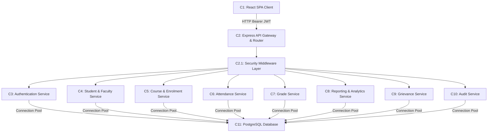
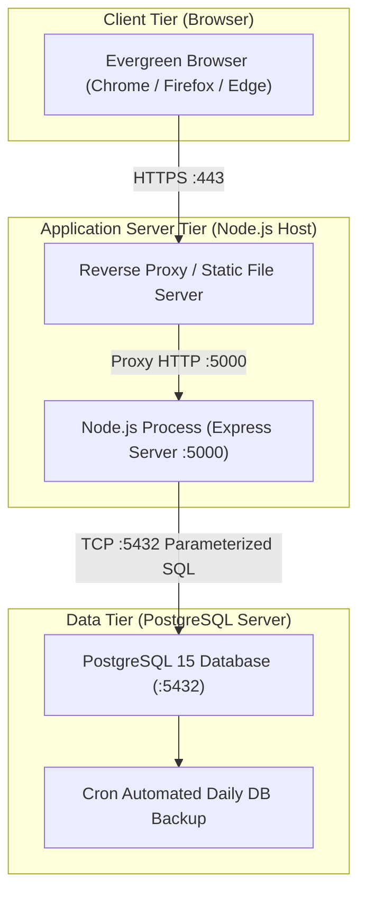
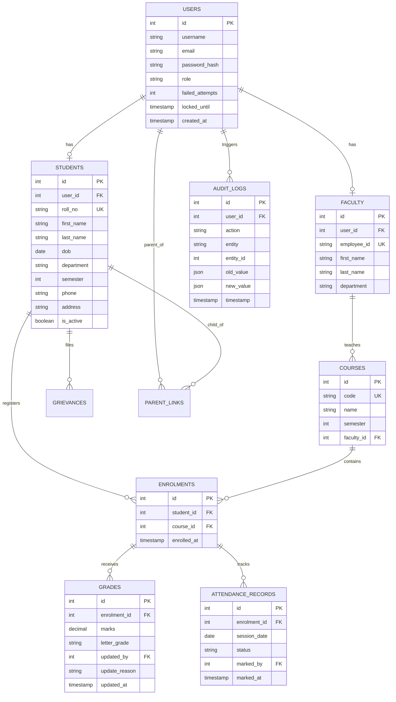
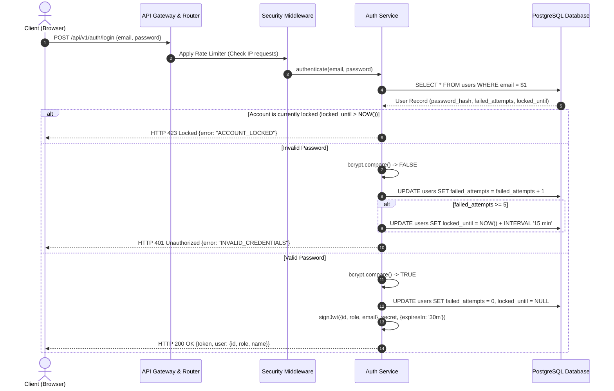
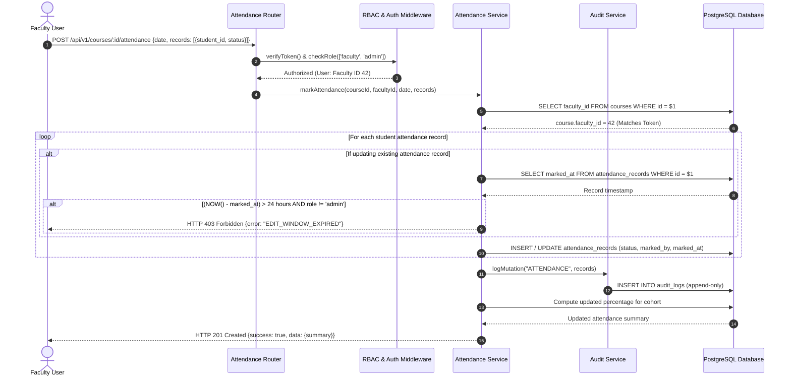
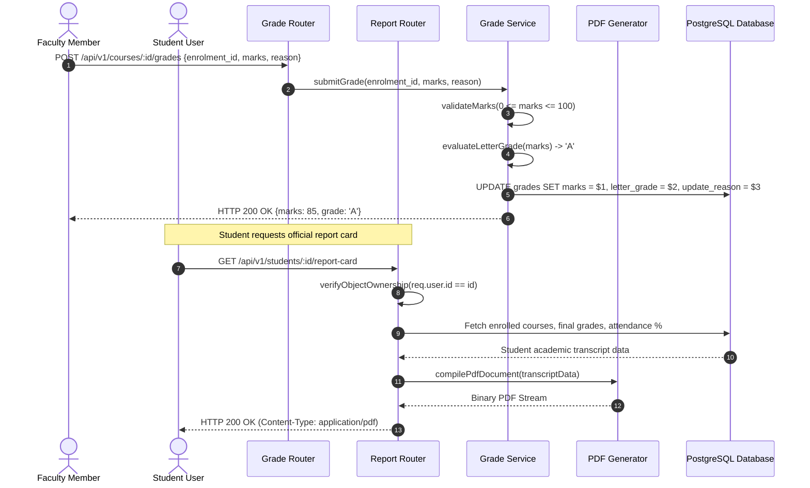

# Student Record System
## Software Architecture & Design Specification (SADS)
**Deliverable 3 of 4 - Mini-Project Part 1**  
*Prepared following IEEE Std 1016-2009 (Software Design Descriptions) and ISO/IEC/IEEE 42010*

---

| **Attribute** | **Details** |
|---|---|
| **Document ID** | SADS-SRSYS-01 |
| **Version** | 1.0 |
| **Release Date** | 28 September 2026 |
| **Associated SRS** | SRS-SRSYS-01 v1.0 |
| **Team Name** | TEAM-E12 |

### Team Members & Design Assignments
| Name | Student SRN / USN | Role | Architecture & Design Focus |
|---|---|---|---|
| **Nagashree R Patil** | PES1UG24CS289 | Lead Architect / Full Stack | Attendance Subsystem, Edit Window Boundary, CI Pipeline |
| **Monika PM** | PES1UG24CS275 | Security Architect | Auth Service, JWT Session Engine, RBAC Middleware |
| **Kushita K** | PES1UG24CS247 | Systems & Database Architect | Database Schema, Relational Indexing, Course Services |
| **Nidhi L** | PES1UG24CS298 | Frontend Architect | Client SPA Architecture, UI State Management, Reports & Portals |

---

## Table of Contents
### PART A - ARCHITECTURE
1. [Introduction & Scope](#1-introduction)
2. [Architectural Pattern](#2-architectural-pattern)
3. [Component View and Detailed Description](#3-component-view-and-description)
4. [Traceability to Requirements](#4-traceability-to-requirements)
5. [Security Architecture & Threat Modeling](#5-security-architecture)
6. [Deployment Architecture](#6-deployment-view)
7. [Data Architecture](#7-data-architecture)

### PART B - DETAILED DESIGN
8. [UML Sequence Diagrams](#8-uml-sequence-diagrams)
   - 8.1 SD-1: User Authentication and JWT Issuance
   - 8.2 SD-2: Faculty Attendance Marking & 24-Hour Edit Window
   - 8.3 SD-3: Grade Entry, Letter Grade Evaluation & Report Card Generation
9. [REST API Design Specification](#9-api-design)
10. [Error Handling Strategy](#10-error-handling)
11. [Database Schema & Entity-Relationship (ER) Diagram](#11-database-design)
12. [Architectural Decisions & Trade-Offs](#12-design-constraints-and-decisions)

---

## PART A - ARCHITECTURE

## 1. Introduction

### 1.1 Purpose and Scope
This specification describes the high-level architecture and low-level component designs for the **Student Record System**. It bridges the functional and non-functional requirements established in `SRS-SRSYS-01` with the physical codebase, establishing strict separation of concerns, defensive security measures, and scalable transaction handling.

### 1.2 Architectural Drivers
- **Strict Separation of Concerns:** Decouple user interface representation from business rules and persistence (supporting NFR-07).
- **Defense in Depth:** Enforce authentication, authorization, rate limiting, and parameter validation uniformly at the gateway layer (supporting SEC-01 to SEC-09).
- **Stateless Application Layer:** Sessions encapsulated within cryptographically signed JWT tokens, allowing horizontal container scaling without sticky sessions (supporting NFR-01, NFR-03).
- **ACID Transaction Atomicity:** Guaranteeing database integrity for academic grading and attendance histories (supporting NFR-09).

---

## 2. Architectural Pattern

The system follows a classic **3-Tier Layered Client-Server Architecture** with a Service-Oriented backend modularization:

```mermaid
flowchart TD
    subgraph PresentationTier ["Tier 1: Presentation Tier (Client)"]
        ReactApp["React 19 Single Page Application (Vite)"]
        UI_Admin["Admin Portal"]
        UI_Faculty["Faculty Portal"]
        UI_Student["Student Portal"]
        UI_Parent["Parent Portal"]
        ReactApp --> UI_Admin
        ReactApp --> UI_Faculty
        ReactApp --> UI_Student
        ReactApp --> UI_Parent
    end

    subgraph ApplicationTier ["Tier 2: Application Tier (Node.js / Express)"]
        Gateway["Express Router & API Gateway (/api/v1)"]
        
        subgraph SecurityLayer ["Defense-in-Depth Middleware"]
            CorsHelmet["CORS & Helmet Security Headers"]
            RateLimiter["Rate Limiting Middleware (100 req/min)"]
            AuthMW["JWT Auth & Session Verification"]
            RBACMW["Role-Based & Object-Level Access Control"]
            ValidationMW["Request Schema Validator"]
        end

        subgraph ServiceLayer ["Domain Services"]
            AuthService["Auth Service (Bcrypt, Lockout)"]
            StudentService["Student & Faculty Management Service"]
            CourseService["Course & Enrolment Service"]
            AttendanceService["Attendance Service (24h Window)"]
            GradeService["Grade Service (Letter Grading)"]
            ReportService["Report & PDF Generation Service"]
            AuditService["Audit Log Service"]
            GrievanceService["Grievance Lifecycle Service"]
        end

        CentralError["Centralized Error Handling Middleware"]
    end

    subgraph DataTier ["Tier 3: Data Persistence Tier"]
        PostgresDB[("PostgreSQL 15 Relational DB")]
        AuditStore[("Append-Only Audit Log Storage")]
        PDFStore[("Temporary File Cache")]
    end

    ReactApp -->|HTTPS / REST API / JSON| Gateway
    Gateway --> CorsHelmet --> RateLimiter --> AuthMW --> RBACMW --> ValidationMW
    ValidationMW --> ServiceLayer
    ServiceLayer --> CentralError
    ServiceLayer -->|Parameterized SQL Queries (pg)| PostgresDB
    AuditService -->|Append-Only Writes| AuditStore
    ReportService -->|Cached Artifacts| PDFStore
```

---

## 3. Component View and Description

### 3.1 Component Diagram


### 3.2 Component Responsibilities
| Component ID | Component Name | Primary Responsibility |
|---|---|---|
| **C1** | React Single-Page App | Presentation logic, state management, role-based screen routing. |
| **C2** | API Gateway & Router | Single entry point for `/api/v1/`, route dispatch, TLS termination. |
| **C2.1** | Security Middleware | Token verification, RBAC authorization, rate limiting, error normalization. |
| **C3** | Auth Service | Password validation via bcrypt, account lockout counter, JWT generation. |
| **C4** | Student & Faculty Service| CRUD for student profiles, soft-deletion, faculty accounts. |
| **C5** | Course Service | Course cataloging, faculty allocations, student semester enrollments. |
| **C6** | Attendance Service | Per-session attendance entry, 24-hr edit limit check, percentage math. |
| **C7** | Grade Service | Marks validation (0-100), automated letter grading, amendment logging. |
| **C8** | Report & PDF Service | Cohort summaries, PDF report cards generation. |
| **C9** | Grievance Service | Academic dispute ticketing, tracking, and faculty responses. |
| **C10** | Audit Service | Non-repudiable transaction logging to append-only database table. |
| **C11** | PostgreSQL Data Tier | ACID transaction persistence, relational integrity, table constraints. |

---

## 4. Traceability to Requirements

| Requirement ID | Realizing Architecture Component(s) | Design Mechanism |
|---|---|---|
| **FR-01** | C1, C2, C2.1, C3 | JWT Bearer token generation, bcrypt verification |
| **FR-02, FR-03** | C1, C4, C11 | Student CRUD endpoints with UNIQUE roll_number constraint |
| **FR-04, FR-05** | C1, C4, C5, C11 | Faculty management, course-faculty foreign key mappings |
| **FR-06, FR-07** | C1, C7, C10, C11 | Grade validation middleware, mandatory reason audit check |
| **FR-08, FR-09** | C1, C6, C10, C11 | Attendance array parser, 24-hour timestamp validator, SQL aggregation |
| **FR-10, FR-11** | C1, C7, C8, C11 | Object-level auth check (`req.user.student_id == params.id`), PDFKit engine |
| **FR-12** | C1, C2.1, C4, C11 | Parent link table verification |
| **FR-13** | C6, C8 | Event trigger on attendance update with percentage < 75% |
| **FR-14** | C1, C8, C11 | SQL aggregation queries with CSV/PDF output streaming |
| **FR-15** | C1, C9, C11 | Status state-machine (Open -> In Review -> Resolved) |
| **FR-16** | C2.1, C10, C11 | Interceptor middleware writing to append-only `audit_logs` |
| **FR-17** | C1, C4, C11 | Endpoint restricting student updates solely to contact fields |
| **NFR-01, NFR-03**| C2, C11 | Indexed SQL lookups, stateless HTTP pooling, connection pooling |
| **NFR-02** | C8, C11 | Optimized JOIN queries with composite indexes |
| **NFR-07** | All Components | Modular directory layout, Jest automated testing, OpenAPI specs |
| **NFR-09** | C6, C7, C11 | Explicit `BEGIN...COMMIT/ROLLBACK` transactional queries |
| **SEC-01 to SEC-09**| C2.1, C3, C10 | Bcrypt hashing, RBAC router middleware, rate limiter, helmet |

---

## 5. Security Architecture

### 5.1 Defense-in-Depth Layers
1. **Network Perimeter:** Reverse proxy terminating TLS 1.2/1.3, forwarding HTTPS traffic, rejecting unencrypted HTTP.
2. **Gateway Protection:** `express-rate-limit` restricting IPs to 100 requests per minute; `helmet` enforcing security headers (CSP, HSTS, X-Frame-Options).
3. **Session Layer:** HMAC-SHA256 signed JSON Web Tokens containing `sub`, `role`, and `exp` claims with 30-minute validity.
4. **Authorization Layer:** Middleware checking `req.user.role` against endpoint whitelist, verifying object ownership for student and parent queries.
5. **Persistence Layer:** SQL queries executed via parameterized placeholders (`$1, $2`), preventing SQL injection; `audit_logs` table protected with restricted permissions.

### 5.2 STRIDE Threat Modeling
| STRIDE Category | Potential Vulnerability | Mitigating Control |
|---|---|---|
| **Spoofing** | Forged identity / token replay | Cryptographically signed JWTs; bcrypt password hashing with salt. |
| **Tampering** | Modifying marks via direct API calls | Server-side role check; 24-hr edit window; mandatory audit justification. |
| **Repudiation** | Denying unauthorized grade change | Append-only audit log tracking user ID, IP address, timestamp, and values. |
| **Information Disclosure** | IDOR: Viewing another student's marks | Object-level authorization middleware validating token ID against requested ID. |
| **Denial of Service** | Volumetric brute-force login attack | 5-attempt account lockout; rate limiting at 100 requests/minute. |
| **Elevation of Privilege** | Student invoking admin endpoints | Strict RBAC middleware rejecting unauthorized roles with HTTP 403. |

---

## 6. Deployment View



---

## 7. Data Architecture

The database architecture is designed with 3rd Normal Form (3NF) principles, enforcing referential integrity through foreign keys with CASCADE and SET NULL constraints:



---

## PART B - DETAILED DESIGN

## 8. UML Sequence Diagrams

### 8.1 SD-1: User Authentication & JWT Issuance (FR-01, SEC-01, SEC-04, SEC-05)


### 8.2 SD-2: Faculty Attendance Marking & 24-Hour Edit Window (FR-08, FR-09, SEC-02)


### 8.3 SD-3: Grade Entry, Letter Grade Evaluation & Report Card (FR-06, FR-11, SEC-08)


---

## 9. REST API Design

All endpoints follow versioning under `/api/v1` and return the standard JSON envelope:

| HTTP Verb | Endpoint Path | Access Scope | Description | Status Codes |
|---|---|---|---|---|
| `POST` | `/api/v1/auth/login` | Public | Authenticates credentials and issues 30-min JWT. | 200, 400, 401, 423 |
| `POST` | `/api/v1/auth/logout` | Authenticated | Invalidates client session. | 200, 401 |
| `GET` | `/api/v1/students` | Admin, Faculty | Queries student roster with pagination and department filters. | 200, 401, 403 |
| `POST` | `/api/v1/students` | Admin | Enrolls a new student; checks roll_no uniqueness. | 201, 400, 409 |
| `GET` | `/api/v1/students/:id` | Admin, Student(self), Parent(linked) | Fetches complete student academic profile. | 200, 401, 403, 404 |
| `PUT` | `/api/v1/students/:id` | Admin | Updates student demographic or academic fields. | 200, 400, 404 |
| `PATCH` | `/api/v1/students/:id/contact`| Student(self), Admin | Updates personal phone, email, and address only. | 200, 400, 403 |
| `DELETE`| `/api/v1/students/:id` | Admin | Soft-deletes student record (`is_active = false`). | 200, 404 |
| `GET` | `/api/v1/courses` | Authenticated | Lists courses assigned to user or whole catalog for Admin. | 200, 401 |
| `POST` | `/api/v1/courses` | Admin | Creates new semester course and assigns faculty. | 201, 400, 409 |
| `POST` | `/api/v1/courses/:id/attendance`| Faculty(assigned), Admin | Records or updates attendance session records. | 201, 400, 403 |
| `GET` | `/api/v1/courses/:id/attendance`| Faculty, Admin | Retrieves session attendance grid and percentages. | 200, 403 |
| `POST` | `/api/v1/courses/:id/grades` | Faculty(assigned), Admin | Enters marks (0-100) and computes letter grade. | 200, 400, 403 |
| `GET` | `/api/v1/students/:id/report-card`| Student(self), Parent, Admin | Streams generated PDF report card. | 200, 403, 404 |
| `GET` | `/api/v1/reports/class/:courseId` | Faculty(assigned), Admin | Generates class summary report with CSV export. | 200, 403 |
| `POST` | `/api/v1/grievances` | Student | Submits academic evaluation grievance. | 201, 400 |
| `PATCH` | `/api/v1/grievances/:id` | Faculty, Admin | Updates grievance status and resolution text. | 200, 400, 403 |
| `GET` | `/api/v1/audit-logs` | Admin | Reads immutable system audit trail with filters. | 200, 403 |
| `GET` | `/api/v1/health` | Public | System liveness, database connection, and uptime check. | 200, 503 |

---

## 10. Error Handling

### 10.1 Standard Error Envelope
All error responses adhere to a consistent RFC-compliant payload structure:
```json
{
  "success": false,
  "error": {
    "code": "VALIDATION_ERROR",
    "message": "Marks must be an integer between 0 and 100",
    "details": [
      { "field": "marks", "issue": "Value 110 exceeds upper limit of 100" }
    ],
    "timestamp": "2026-10-15T10:30:00.000Z"
  }
}
```

### 10.2 HTTP Status Code Strategy
| HTTP Status | Application Error Code | Context / Trigger Condition |
|---|---|---|
| **400 Bad Request** | `INVALID_INPUT` / `VALIDATION_ERROR` | Missing mandatory payload fields; marks outside [0, 100]. |
| **401 Unauthorized**| `TOKEN_EXPIRED` / `UNAUTHORIZED` | Missing or invalid Authorization header; expired JWT. |
| **403 Forbidden** | `FORBIDDEN` / `EDIT_WINDOW_EXPIRED` | Role lacking permission; faculty editing after 24 hours. |
| **404 Not Found** | `RESOURCE_NOT_FOUND` | Student ID or Course ID does not exist in database. |
| **409 Conflict** | `DUPLICATE_ENTITY` | Roll number or Course code already exists. |
| **423 Locked** | `ACCOUNT_LOCKED` | Account temporarily suspended due to 5 failed logins. |
| **429 Too Many Req**| `RATE_LIMIT_EXCEEDED` | Client IP exceeds 100 requests within a 60-second window. |
| **500 Server Error**| `INTERNAL_SERVER_ERROR` | Unhandled runtime exception; sanitized before client output. |

---

## 11. Database Design

### 11.1 Key Database Tables & Constraints
```sql
-- Core users table with account lockout protection
CREATE TABLE users (
    id SERIAL PRIMARY KEY,
    username VARCHAR(50) UNIQUE NOT NULL,
    email VARCHAR(100) UNIQUE NOT NULL,
    password_hash VARCHAR(255) NOT NULL,
    role VARCHAR(20) NOT NULL CHECK (role IN ('admin', 'faculty', 'student', 'parent')),
    failed_attempts INT DEFAULT 0,
    locked_until TIMESTAMP NULL,
    created_at TIMESTAMP DEFAULT CURRENT_TIMESTAMP
);

-- Students profile table
CREATE TABLE students (
    id SERIAL PRIMARY KEY,
    user_id INT UNIQUE REFERENCES users(id) ON DELETE CASCADE,
    roll_no VARCHAR(20) UNIQUE NOT NULL,
    first_name VARCHAR(50) NOT NULL,
    last_name VARCHAR(50) NOT NULL,
    dob DATE NOT NULL,
    department VARCHAR(50) NOT NULL,
    semester INT NOT NULL CHECK (semester BETWEEN 1 AND 8),
    phone VARCHAR(20),
    address TEXT,
    is_active BOOLEAN DEFAULT TRUE
);

-- Courses catalogue table
CREATE TABLE courses (
    id SERIAL PRIMARY KEY,
    code VARCHAR(20) UNIQUE NOT NULL,
    name VARCHAR(100) NOT NULL,
    semester INT NOT NULL,
    faculty_id INT REFERENCES faculty(id) ON DELETE SET NULL
);

-- Per-session attendance records with 24-hr timestamp enforcement
CREATE TABLE attendance_records (
    id SERIAL PRIMARY KEY,
    enrolment_id INT REFERENCES enrolments(id) ON DELETE CASCADE,
    session_date DATE NOT NULL,
    status VARCHAR(10) NOT NULL CHECK (status IN ('present', 'absent', 'late')),
    marked_by INT REFERENCES users(id),
    marked_at TIMESTAMP DEFAULT CURRENT_TIMESTAMP,
    CONSTRAINT unique_session_student UNIQUE (enrolment_id, session_date)
);

-- Immutable audit log table
CREATE TABLE audit_logs (
    id BIGSERIAL PRIMARY KEY,
    user_id INT REFERENCES users(id),
    action VARCHAR(50) NOT NULL,
    entity VARCHAR(50) NOT NULL,
    entity_id INT NOT NULL,
    old_value JSONB,
    new_value JSONB,
    timestamp TIMESTAMP DEFAULT CURRENT_TIMESTAMP
);
```

---

## 12. Architectural Decisions & Trade-Offs

1. **Relational Database (PostgreSQL) vs. Document NoSQL (MongoDB):**  
   *Decision:* PostgreSQL selected.  
   *Rationale:* Academic grading and attendance require ACID compliance, foreign-key relational integrity, and cross-table aggregation for GPA computation.
2. **Stateless JWT Sessions vs. Server Memory Sessions (Redis):**  
   *Decision:* Stateless signed JWT tokens.  
   *Rationale:* Eliminates session store dependencies, enables horizontal container scaling, and meets NFR-01 latency requirements.
3. **Dedicated Security Middleware Layer vs. Per-Route Handlers:**  
   *Decision:* Centralized middleware pipeline.  
   *Rationale:* Eliminates developer omission risks for authorization checks and guarantees uniform audit logging across all state mutations.
